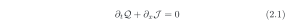
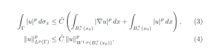

🇬🇧 [English](README.md) · 🇧🇷 [Português](README.pt-BR.md) · 🇮🇹 **Italiano**

# Equazioni LaTeX numerate su GitHub

Scrivi le equazioni come in un articolo — `\begin{equation}`, `align`, `\label`,
un preambolo comune, numerazione per sezione — e mostrale in qualsiasi README di
GitHub con il numero sul margine destro, nei temi chiaro e scuro.

## Il problema

GitHub mostra le formule `$$ … $$` nel Markdown, ma la numerazione delle
equazioni non funziona bene ([discussione #212507](https://github.com/orgs/community/discussions/212507)):

- `\tag{2.1}` schiaccia l'equazione in una stretta colonna verticale in Chrome
  e Firefox, e in Safari il numero compare a **sinistra**;
- `\tag*{…}` si rompe allo stesso modo;
- `\begin{equation}` compare senza numero, e `\label` / `\eqref` non hanno effetto;
- non c'è un preambolo: `\newcommand` con argomenti viene rifiutato
  (`'#' can not be used here`);
- `\qquad\text{(2.1)}` è leggibile, ma il numero resta attaccato all'equazione
  e non si può citare.

## La soluzione: lasciar compilare il vero LaTeX e mostrare il risultato

1. Ogni equazione sta in un normale file `.tex` nella cartella [`equations/`](equations),
   che inizia con `\input{preamble}` ([`preamble.tex`](equations/preamble.tex)).
2. Un [workflow di GitHub Actions](.github/workflows/equations.yml) compila ogni
   file con LaTeX e lo trasforma in due immagini SVG: testo scuro per il tema
   chiaro e testo chiaro per il tema scuro, su sfondo trasparente.
3. Il README mostra l'immagine giusta per il tema di ogni lettore.

## Esempio 1 · l'equazione della discussione

L'equazione di esempio viene dalla segnalazione di [@gustavdelius](https://github.com/gustavdelius) nella [discussione #212507](https://github.com/orgs/community/discussions/212507), che ha ispirato questo repository.

<picture>
  <source media="(prefers-color-scheme: dark)" srcset="equations/conservation-dark.svg">
  
</picture>

## Esempio 2 · il Teorema della Traccia

Dalla mia domanda su Mathematics Stack Exchange,
[*Would you please check some steps in proof I tried of Trace Theorem from Evans book?*](https://math.stackexchange.com/q/4828736)
(dicembre 2023). Esiste un operatore lineare limitato

<picture>
  <source media="(prefers-color-scheme: dark)" srcset="equations/trace-theorem-dark.svg">
  
</picture>

e, per un bordo localmente piatto, il primo passo della dimostrazione dà

<picture>
  <source media="(prefers-color-scheme: dark)" srcset="equations/trace-step1-dark.svg">
  
</picture>

La disuguaglianza (4) è la (3) scritta con le norme. In ogni file `.tex`,
`\label` e `\eqref` funzionano normalmente; nel testo del README, i riferimenti
come “(4)” si scrivono a mano.

## Usalo nel tuo repository

1. Copia la cartella [`equations/`](equations) (con `preamble.tex`) e il file
   [`.github/workflows/equations.yml`](.github/workflows/equations.yml).
2. Scrivi ogni equazione in un proprio file `.tex`, che inizia con `\input{preamble}`.
3. Fai il push. In circa un minuto, il workflow crea `nome.svg` e `nome-dark.svg`.
4. Mostrala nel README:

```html
<picture>
  <source media="(prefers-color-scheme: dark)" srcset="equations/nome-dark.svg">
  
</picture>
```

Cambia `width="620"` per rendere le equazioni più grandi o più piccole.

## Limiti

- Ogni equazione è un'immagine: il suo testo non si può selezionare né copiare.
- I riferimenti nel testo del README si scrivono a mano, senza link.
- Le immagini si aggiornano circa un minuto dopo ogni push.
