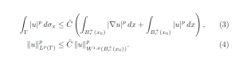

🇬🇧 **English** · 🇧🇷 [Português](README.pt-BR.md) · 🇮🇹 [Italiano](README.it.md)

# Numbered LaTeX equations on GitHub

Write equations as you would in a paper — `\begin{equation}`, `align`,
`\label`, a shared preamble, section-style numbering — and show them in any
GitHub README with the number on the right margin, in both light and dark themes.

## The problem

GitHub renders `$$ … $$` math in Markdown, but equation numbering does not work
well ([discussion #212507](https://github.com/orgs/community/discussions/212507)):

- `\tag{2.1}` squeezes the equation into a narrow vertical column in Chrome and
  Firefox, and in Safari the number appears on the **left**;
- `\tag*{…}` breaks in the same way;
- `\begin{equation}` is shown without a number, and `\label` / `\eqref` have no effect;
- there is no preamble: `\newcommand` with arguments is rejected
  (`'#' can not be used here`);
- `\qquad\text{(2.1)}` is readable, but the number sits next to the equation
  and cannot be referenced.

## The solution: let real LaTeX compile, and show the result

1. Each equation lives in a normal `.tex` file in [`equations/`](equations),
   starting with `\input{preamble}` ([`preamble.tex`](equations/preamble.tex)).
2. A [GitHub Actions workflow](.github/workflows/equations.yml) compiles every
   file with LaTeX and turns it into two SVG images: dark text for the light
   theme and light text for the dark theme, on a transparent background.
3. The README shows the right image for each reader's theme.

## Example 1 · the equation from the discussion

<picture>
  <source media="(prefers-color-scheme: dark)" srcset="equations/conservation-dark.svg">
  
</picture>

## Example 2 · the Trace Theorem

From my question on Mathematics Stack Exchange,
[*Would you please check some steps in proof I tried of Trace Theorem from Evans book?*](https://math.stackexchange.com/q/4828736)
(December 2023). There exists a bounded linear operator

<picture>
  <source media="(prefers-color-scheme: dark)" srcset="equations/trace-theorem-dark.svg">
  
</picture>

and, for a locally flat boundary, the first step of the proof gives

<picture>
  <source media="(prefers-color-scheme: dark)" srcset="equations/trace-step1-dark.svg">
  
</picture>

Inequality (4) is (3) written with norms. Inside each `.tex` file, `\label` and
`\eqref` work as usual; in the README text, references such as “(4)” are typed
by hand.

## Use it in your own repository

1. Copy the [`equations/`](equations) folder (with `preamble.tex`) and the
   [`.github/workflows/equations.yml`](.github/workflows/equations.yml) file.
2. Write each equation in its own `.tex` file, starting with `\input{preamble}`.
3. Push. In about a minute, the workflow creates `name.svg` and `name-dark.svg`.
4. Show it in the README:

```html
<picture>
  <source media="(prefers-color-scheme: dark)" srcset="equations/name-dark.svg">
  
</picture>
```

Change `width="620"` to make the equations larger or smaller.

## Limitations

- Each equation is an image: its text cannot be selected or copied.
- References in the README text are typed by hand, not clickable.
- The images are updated about a minute after each push.
