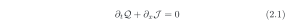
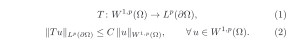
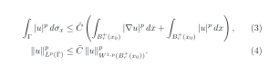

🇬🇧 [English](README.md) · 🇧🇷 **Português** · 🇮🇹 [Italiano](README.it.md)

# Equações LaTeX numeradas no GitHub

Escreva as equações como num artigo — `\begin{equation}`, `align`, `\label`,
um preâmbulo comum, numeração por seção — e mostre-as em qualquer README do
GitHub com o número na margem direita, nos temas claro e escuro.

> **Uma saída temporária, enquanto esperamos uma correção de verdade.**
>
> Encontrei o relato de [@gustavdelius](https://github.com/gustavdelius) na [discussão #212507](https://github.com/orgs/community/discussions/212507) e constatei as
> mesmas dificuldades. Na matemática, escrevemos em LaTeX todos os dias, e
> equações numeradas com `\label` e `\eqref` fazem parte do nosso trabalho.
> No GitHub, elas ainda não funcionam.
>
> Este repositório é a saída que encontrei por enquanto: se alguém precisar de
> equações numeradas num README hoje, aqui está um exemplo de como fazer. Não é
> assim que deveríamos trabalhar no dia a dia, e esperamos que a comunidade do
> GitHub resolva o problema em breve.

## O problema

O GitHub mostra fórmulas `$$ … $$` no Markdown, mas a numeração de equações não
funciona bem:

- `\tag{2.1}` espreme a equação numa coluna vertical estreita no Chrome e no
  Firefox, e no Safari o número aparece à **esquerda**;
- `\tag*{…}` quebra do mesmo jeito;
- `\begin{equation}` aparece sem número, e `\label` / `\eqref` não têm efeito;
- não há preâmbulo: `\newcommand` com argumentos é recusado
  (`'#' can not be used here`);
- `\qquad\text{(2.1)}` fica legível, mas o número fica colado à equação e não
  pode ser referenciado.

## A saída por enquanto: deixar o LaTeX de verdade compilar e mostrar o resultado

1. Cada equação fica num arquivo `.tex` normal na pasta [`equations/`](equations),
   começando com `\input{preamble}` ([`preamble.tex`](equations/preamble.tex)).
2. Uma [automação do GitHub Actions](.github/workflows/equations.yml) compila
   cada arquivo com o LaTeX e gera duas imagens SVG: letras escuras para o tema
   claro e letras claras para o tema escuro, com fundo transparente.
3. O README mostra a imagem certa para o tema de cada leitor.

## Exemplo 1 · a equação da discussão

A equação de exemplo vem do relato de [@gustavdelius](https://github.com/gustavdelius) na [discussão #212507](https://github.com/orgs/community/discussions/212507), que inspirou este repositório.

<picture>
  <source media="(prefers-color-scheme: dark)" srcset="equations/conservation-dark.svg">
  
</picture>

## Exemplo 2 · o Teorema do Traço

Da minha pergunta no Mathematics Stack Exchange,
[*Would you please check some steps in proof I tried of Trace Theorem from Evans book?*](https://math.stackexchange.com/q/4828736)
(dezembro de 2023). Existe um operador linear limitado

<picture>
  <source media="(prefers-color-scheme: dark)" srcset="equations/trace-theorem-dark.svg">
  
</picture>

e, para uma fronteira localmente plana, o primeiro passo da demonstração dá

<picture>
  <source media="(prefers-color-scheme: dark)" srcset="equations/trace-step1-dark.svg">
  
</picture>

A desigualdade (4) é a (3) escrita com normas. Dentro de cada arquivo `.tex`,
`\label` e `\eqref` funcionam normalmente; no texto do README, referências como
“(4)” são escritas à mão.

## Use no seu próprio repositório

1. Copie a pasta [`equations/`](equations) (com o `preamble.tex`) e o arquivo
   [`.github/workflows/equations.yml`](.github/workflows/equations.yml).
2. Escreva cada equação num arquivo `.tex` próprio, começando com `\input{preamble}`.
3. Envie ao GitHub. Em cerca de um minuto, a automação cria `nome.svg` e `nome-dark.svg`.
4. Mostre no README:

```html
<picture>
  <source media="(prefers-color-scheme: dark)" srcset="equations/nome-dark.svg">
  
</picture>
```

Mude `width="620"` para deixar as equações maiores ou menores.

## Limitações

- Cada equação é uma imagem: não dá para selecionar nem copiar o texto dela.
- As referências no texto do README são escritas à mão, sem link.
- As imagens são atualizadas cerca de um minuto depois de cada envio.
